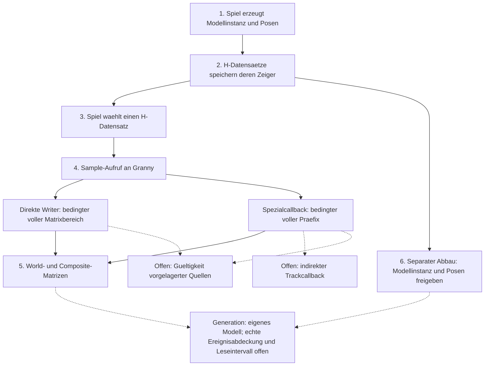

# Wissenskarte: Animation und Pose

> Kurzfassung: Verstaendlicher Einstieg in den bisher belegten Animationspfad: Erzeugen, Speichern, Auswaehlen, Berechnen und Freigeben. Jede Station verlinkt Fakten und Nachweise; Bedingungen und offene Verbindungen bleiben sichtbar. Diese Karte ersetzt weder Evidenz noch den aktuellen Auftrag in STATE.

Aktualisiert: 2026-10-18. Forschungsstand: F148–F179, mit den jeweils verlinkten Evidenzstaenden. Diese Karte ordnet vorhandenes Wissen;
sie fuegt keinen neuen Binaerbefund hinzu. Fuer den aktuellen Arbeitsauftrag zuerst [STATE.md](STATE.md) lesen.

## Der Ablauf auf einen Blick

Das Spiel waehlt einen gespeicherten Modell-/Pose-Datensatz und uebergibt seine Zeiger an Granny.
Granny berechnet daraus Knochenmatrizen. Ein separater Abbaupfad gibt die Objekte wieder frei.
Die Pfeile zeigen belegte Teilverbindungen mit Voraussetzungen, keine lueckenlose Ereignishistorie aller Objekte.

**Leseregel:** Ein voller Schreibbereich gilt nur fuer den jeweils beschriebenen Pfad und dessen gueltige
Eingaben. Eine durchgezogene Verbindung im Schema bedeutet keine universelle Laufzeitgarantie.
Die Freigabe ist kein automatischer Schritt nach jedem Sample. Insbesondere ist das nach Sample aufgerufene
`FreeCompletedModelControls` nicht mit der Freigabe von WorldPose/LocalPose gleichzusetzen.

## Was die einzelnen Stationen bedeuten

### 1. Erzeugen: Die Objekte entstehen

Ein untersuchter Spielpfad erzeugt eine Granny-Modellinstanz, eine WorldPose und eine LocalPose.
Dieselbe gelesene Skelett-Knochenzahl geht an beide Pose-Konstruktoren. Die Allokation einer WorldPose
initialisiert ihre Matrixdaten noch nicht.

**Belegt:** F150, F154. **Offen:** Erfolg und Fortbestand jeder konkreten spaeter verwendeten Allokation.
[Posevertrag](evidence/POSE_CONTRACT_2026-10-16.md),
[Erzeugungspfad](evidence/HPOSE_CREATION_2026-10-17.md).

### 2. Speichern: H ist eine kleine Zeigersammlung

Ein H-Datensatz belegt 20 Byte. Er enthaelt Zeiger auf Modellinstanz, WorldPose und LocalPose sowie einen
Ressourcenverweis und ein weiteres nicht geklaertes Feld. H ist nicht die Pose selbst und nicht nachweislich
ein Soldat. Sein Array kann wachsen; dabei werden die gespeicherten Zeiger uebertragen, keine neuen Posen erzeugt.

**Belegt:** F149, F154, F156/F157. **Offen:** Eine vollstaendige dynamische Herkunfts- und Wiederverwendungskette.
[Arraygroesse und Transfer](evidence/HPOSE_ALLOCATION_2026-10-17.md).

### 3. Auswaehlen: Welcher Datensatz wird verwendet?

Ein untersuchter Auswahlpfad greift auf dieses Array zu und speichert den ausgewaehlten H-Zeiger in O+0x4C.
Die strukturelle Verbindung zwischen Erzeugung und Auswahl ist belegt. Ein nichtnull Auswahlzeiger garantiert
jedoch keine lebenden referenzierten Posen: Beim Abbau wird er erst nach deren Free-Aufrufen geloescht.

**Belegt:** F155, F158. **Offen:** Dass jedes laufende O/H-Objekt aus dem bekannten Pfad stammt und noch gueltig ist.
[Auswahl](evidence/HPOSE_CREATION_2026-10-17.md),
[spaeter Auswahl-Reset](evidence/HPOSE_CLEANUP_2026-10-17.md).

### 4. Berechnen: Sample hat mehrere Wege

Der Spielaufruf uebergibt Modellinstanz, angeforderte Knochenzahl, eine Matrix sowie LocalPose und WorldPose.
Im untersuchten Granny-Pfad werden je nach Kontrollliste verschiedene Berechnungswege gewaehlt:

- **Direkte Writer:** Unter belegten Voraussetzungen werden aufeinanderfolgende World-/Composite-Matrizen
  vollstaendig geschrieben. Im Mehrkontrollzweig bleibt die vorgelagerte Produktion gueltiger LocalPose-Werte offen.
- **Spezialcallback:** Fuer einen Animations-Erzeugungspfad ist ein konkreter Descriptor mit Callbackkandidat
  `0x1C780` gefunden. Ohne Schnellroute und bei bekannten direkten Helfern in jeder Iteration ist ein voller
  Matrixpraefix belegt. Die tatsächliche lebende Zielbindung bleibt eine Bedingung.
- **Schnellroute:** Alle drei Zweige schreiben die erste World-/Composite-Matrix vollstaendig. Ein Zweig
  kopiert Parent und berechnet Composite mit bekanntem Wertevertrag. Bei den beiden anderen bleibt die
  Initialisierung bestimmter Transform-Zwischenwerte offen; die Zielbytes werden trotzdem voll geschrieben.
- **Weitere Grenzen:** Ein indirekter Trackcallback hat noch keinen abgenommenen Schreibvertrag.
  Ein zweiter gefundener Descriptor wurde nur inventarisiert.

**Belegt:** F167–F177. **Offen:** Ein allgemeiner Ausgabeumfang fuer jeden Sample-Aufruf und jede Kontrollart.
[Direkte Writer](evidence/POSE_SAMPLE_EXTENT_2026-10-17.md),
[Spezialcallback](evidence/POSE_SPECIAL_CALLBACK_2026-10-17.md),
[erste-Matrix-Schnellroute](evidence/POSE_FIRST_BONE_FAST_2026-10-18.md).

### 5. Ausgabe: Was ist eine Pose-Matrix?

Eine Matrix enthaelt 16 float32-Werte, also **64 Byte**. World-Matrizen beschreiben die resultierenden
Knochentransformationen; Composite-Matrizen beziehen zusaetzlich die Inverse-Bind-Matrix ein.
Diese zwei Arrays sind verschiedene Ausgaben. Sie sind nicht die fertig verformten Vertices oder das gerenderte Bild.

Drei Groessen duerfen nicht vermischt werden: reservierte Posekapazitaet, angeforderte Samplezahl und
tatsaechlich geschriebener Bereich. Bei gueltigen direkten Samplepfaden ist der belegte Bereich je Array
`[0,B)` Matrizen. Beim selektierten Spezialcallback-Loop ist es `[0,C)` mit `C=min(B,BindingCount)`.
Hier bezeichnet B die bereits gegen die Skelettzahl begrenzte Anfrage. Beide Formeln gelten nur unter den
in ihren Nachweisen genannten Pfad-, Quell-, Kapazitaets- und Hierarchiebedingungen.

**Belegt:** F150/F151, F168/F169, F173/F174. **Offen:** Dass alle angeforderten Matrizen nach einem beliebigen
Sample gueltig lesbar sind. Volle Stores beweisen keine gueltigen Werte aus ungeprueften Quellen.
[Layout und eigener Helfer](evidence/POSE_CONTRACT_2026-10-16.md),
[Voraussetzungen fuer einen Vergleich](design/POSE_COMPARISON_READINESS_2026-10-17.md).

Seit F175–F177 unterscheiden wir genauer: **voll geschriebene Ausgabebytes** koennen fuer einen reinen
Bytevergleich nuetzlich sein, auch wenn die Herkunft einzelner Rechenwerte noch offen ist. Dafuer muessen
lebende Allokation, Kapazitaet und Lesezeitpunkt separat abgesichert sein. Gleiche erste Matrizen beweisen
keine gleiche ganze Pose; ein mathematischer Nachbau hat zusaetzliche Quell-/Wertepflichten.

### 6. Freigeben: Zeiger verlieren ihre Gueltigkeit

Ein belegter Cleanup-Pfad uebergibt die drei H-Felder an FreeModelInstance, FreeWorldPose und FreeLocalPose.
Ein direkter aeusserer Abbaupfad gibt danach das H-Array frei. Die Arrayadresse, gespeicherte Poseadresse
und konkrete Allokationsgeneration sind unterschiedliche Identitaeten.

New/Free delegieren an konfigurierbare Allocatorcallbacks. Gefundene interne Bibliothekscalls umgehen die
oeffentlichen Exporte; nur diese Exporte zu beobachten garantiert deshalb keine globale Vollstaendigkeit.
Ob die ausgewaehlten H-Posen diese weiteren Wege verwenden, ist separat offen. Ein eigenes synthetisches Modell
erkennt gemeldetes Free/Reuse, Luecken und Widersprueche; es erkennt keine still fehlenden Ereignisse und erlaubt
keinen Livezugriff. [Generation, Gegenbeispiele und Lesegrenze](evidence/POSE_GENERATION_READ_WINDOW_2026-10-18.md).

**Belegt:** F158/F159, F178/F179. **Offen:** Vollstaendige relevante Freigabe-/Reuse-Ereignisse und Ausschluss konkurrierender oder
verschachtelter Veraenderungen waehrend einer spaeteren eigenen Lesung.
[Cleanup und aeusserer Abbau](evidence/HPOSE_CLEANUP_2026-10-17.md).

## Zugehoeriger Nebenpfad: Ressourcen

Fuer den Ressourcenverweis im H-Datensatz sind ein Konstruktor-/Freigabekandidat und optionale Lightmap-,
Normalmap- sowie Lights/Occlusion-Verweise untersucht. Direkte Effekte der begrenzten Helfer sind belegt;
daraus folgt keine vollstaendige Ressourcen-Cache-/Lebensdauergarantie. Insbesondere bleibt das dynamische
Ziel des Ressourcen-Freigabeaufrufs offen. Diese Nebenfragen werden nicht automatisch alle weiterverfolgt,
bevor ein enger Posevergleich beurteilt werden kann.

**Belegt:** F160–F166. **Offen:** Globale Aliaswirkungen, Cache-Hit-Herkunft und allgemeine Zielerhaltung.
[Ressourcenherkunft und Kandidat](evidence/HPOSE_RESOURCE_RELEASE_2026-10-17.md),
[optionale Initialisierer](evidence/HPOSE_INITIALIZER_EFFECTS_2026-10-17.md),
[Entscheidung zum begrenzten Vergleich](design/POSE_COMPARISON_READINESS_2026-10-17.md).

## Was wir damit noch nicht wissen

Gleiche beobachtete Eingaben beweisen weder gleiche Ausgaben noch redundante Arbeit. Eine gleiche Adresse
beweist keine gleiche Generation. Ein erfolgreicher Bytevergleich mit der Exe beweist die Fundstelle,
aber nicht automatisch ihre semantische Interpretation. Keiner dieser Befunde erlaubt bisher Cache-/Skiplogik
oder belegt einen Performancegewinn. Die alten Beobachterverluste bleiben ein Messproblem, kein Enginebefund.
[Auditkorrekturen F148](evidence/POSE_CONTRACT_2026-10-16.md).

Der eigene Composite-Helfer wurde gegen die DLL geprueft und erfuellt das deklarierte numerische Kriterium;
er ist nicht allgemein bitgleich (F151/F152). Er ist kein Nachbau der ganzen Animationsengine.

## Wo das Wissen liegt und wie man es prueft

- [FINDINGS.md](FINDINGS.md): dauerhafte F-Kennungen, Aussage, Status und Beleg. Diese Karte ist ein Index dazu.
- [FUNCTIONS.md](FUNCTIONS.md): Arbeitsnamen mit Vertrauensgrad; keine wiedergewonnenen Original-Quellnamen.
- `docs/evidence/`: genaue Modulidentitaeten, RVAs, Bedingungen und Wiederholungsschritte pro Baustein.
- [tools/](../tools/CLAUDE.md): eigene Pruefer, Manifeste und Tests. Fingerprints pruefen Bytes; die semantische
  Argument-/Pfadpruefung ist separat in der Evidenz beschrieben.
- [REPRODUCIBILITY.md](REPRODUCIBILITY.md): trennt spielfreie Tests, eigene Originaldateien und private Rohdaten.
- [STATE.md](STATE.md) und der aktuelle Anfang von [HANDOFF.md](HANDOFF.md): Auftrag und Fortsetzung,
  nicht die einzige Ablage des technischen Wissens. Alte Arbeitsauftraege bleiben historisch.

Alle Moduladressen in der Evidenz sind anhand von Modul und Basis zu lesen: Exe-Basis `0x00400000`,
DLL-Basis `0x50000000`; RVA ist der Abstand zur jeweiligen Basis. Gueltigkeit gilt fuer die dort gehashten Builds.
Ghidra-Datenbanken, Originaldateien und rohe Listings sind kein Bestandteil des veroeffentlichten Wissensbestands.
Lokale Git-Commits sind versionierte Staende, aber noch keine externe Sicherung oder GitHub-Veroeffentlichung.

## Pflege und naechster Einstieg

Bei einem neuen Baustein zuerst dessen Befund und Evidenz erstellen, danach nur die betroffene Station dieser
Karte aktualisieren. Hier keine zweite Kopie aller Adressen, Testergebnisse oder historischen Zwischenstaende
aufbauen. Wenn ein Beleg nur unter Bedingungen gilt, muessen diese auch in der Kurzfassung sichtbar bleiben.

Aktuelle Folgeprioritaet: Veraenderungs-/Weiterleitungspfade der beiden Allocatorslots fuer ausgewaehlte
NewWorldPose-Generationen abgrenzen. Ein sicheres Leseintervall bleibt ein separater Nachweis. Noch kein Observer oder Messlauf.
Offene mathematische Quellfragen bleiben separat. Fuer spaetere Auftraege gilt immer [STATE.md](STATE.md).
